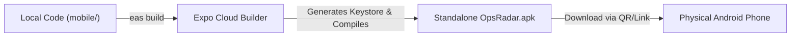
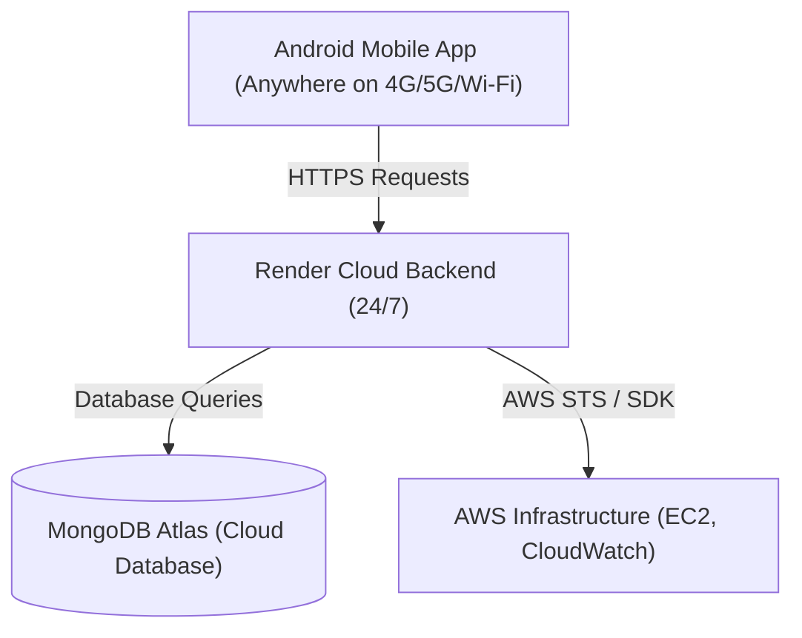

# 📱 Full Production Playbook: Taking Any Mobile App From Code to Live Device

A complete, practical, step-by-step manual for turning any mobile application (E-commerce, SaaS, Social, Booking, Cloud Monitoring) into a live, standalone Android APK and connecting it to a 24/7 cloud backend.

---

## 📑 Table of Contents
1. [Core Architecture & Mandatory Project Files](#1-core-architecture--mandatory-project-files)
2. [Testing on Real Devices (Fast Development)](#2-testing-on-real-devices-fast-development)
3. [Building Standalone Installable Android APKs (100% Cloud, $0 Cost)](#3-building-standalone-installable-android-apks-100-cloud-0-cost)
4. [Deploying Backend to 24/7 Cloud (Render / AWS)](#4-deploying-backend-to-247-cloud-render--aws)
5. [Connecting App to Cloud Backend](#5-connecting-app-to-cloud-backend)
6. [Reusable Production Code Templates](#6-reusable-production-code-templates)
7. [Troubleshooting Guide for Future Projects](#7-troubleshooting-guide-for-future-projects)

---

## 1. Core Architecture & Mandatory Project Files

Regardless of whether your app is an **E-Commerce store**, **Food delivery app**, or **Enterprise monitoring dashboard**, mobile operating systems (Android & iOS) enforce strict rules. 

### Mandatory Configuration Files

| File | Purpose | Why It Is Critical |
| :--- | :--- | :--- |
| **`app.json`** | App identity & OS manifest | Defines your app name, icon, unique Android package identifier (`com.yourcompany.appname`), and target device permissions. |
| **`eas.json`** | Cloud build configurations | Instructs Expo Application Services (EAS) whether to build a direct **`.apk`** (for manual phone install) or an **`.aab`** (for Google Play Store). |
| **`src/api/client.ts`** | Central network layer | Manages API communication, dynamic backend switching (Local vs Cloud), auth tokens, and safe area/network timeouts. |
| **`.gitignore`** | Security gatekeeper | Prevents private keys (`.env`, keystores, credentials) from ever leaking to GitHub. |

---

## 2. Testing on Real Devices (Fast Development)

### The Network Trap: Why Local IPs Fail
When developing on a laptop, your computer runs on a private home Wi-Fi IP (like `http://192.168.1.37:5000`).
- If your phone is on **Mobile Data (4G/5G)**, your phone cannot see your laptop.
- Many Wi-Fi routers have **Client Isolation** enabled, blocking phones from talking to laptops on the same Wi-Fi.

### The Solution: Tunneling
To test instantly on any phone without Wi-Fi issues:

```bash
# 1. Clear bundler cache and start with ngrok tunnel
npx expo start -c --tunnel ngrok

# 2. Or if phone and laptop are on the same Wi-Fi network:
npx expo start -c --lan
```

Scan the terminal QR code with **Expo Go** on your phone.

---

## 3. Building Standalone Installable Android APKs (100% Cloud, $0 Cost)

Running through Expo Go is only for testing. To get an app that stays installed on your phone **permanently** with its own home screen icon (even when your PC is completely turned off):



### Step-by-Step APK Generation:

#### Step 1: Install EAS CLI Globally
```bash
npm install -g eas-cli
```

#### Step 2: Configure `eas.json` in Your Mobile Directory
Create `mobile/eas.json` with the `preview` profile set to `apk`:
```json
{
  "cli": {
    "version": ">= 14.0.0"
  },
  "build": {
    "preview": {
      "distribution": "internal",
      "android": {
        "buildType": "apk"
      }
    },
    "production": {
      "android": {
        "buildType": "apk"
      }
    }
  }
}
```

#### Step 3: Set Package Identifier in `mobile/app.json`
Android requires every app to have a unique reverse-domain package name:
```json
{
  "expo": {
    "name": "YourAppName",
    "slug": "your-app-slug",
    "android": {
      "package": "com.yourname.yourapp"
    }
  }
}
```

#### Step 4: Create Free Account & Log In
1. Register for free at **[expo.dev/signup](https://expo.dev/signup)** (No credit card required; includes 30 free cloud builds per month).
2. Log in from your terminal:
   ```bash
   eas login
   ```

#### Step 5: Trigger the Cloud Build
Run inside your mobile project directory:
```bash
eas build -p android --profile preview
```
- When asked: *"Generate a new Android Keystore?"* → Select **Yes** (Expo manages security signing in the cloud automatically).
- Wait 5–8 minutes. Expo cloud machines compile the complete Android native binary.

#### Step 6: Download & Install on Phone
When finished, the terminal prints a **direct download URL** and **QR code**.
1. Open the URL in **Google Chrome** on your phone.
2. Tap **Download**.
3. **If Android shows "Problem parsing the package"**:
   - Do *not* open from phone's default manufacturer file manager (OnePlus/Realme/Xiaomi file manager bug).
   - Open the **Google Chrome** app → 3 dots → **Downloads** → tap the `.apk` file.
   - Or install **Files by Google** from Play Store and tap the APK to install.

---

## 4. Deploying Backend to 24/7 Cloud (Render / AWS)

A mobile phone needs to talk to a public HTTPS server that never sleeps.



### Deploying Node/TypeScript Backend to Render:

1. Push your backend code to a **GitHub repository**.
2. Go to **[render.com](https://render.com)** → Click **New Web Service** → Connect your GitHub repo.
3. Configure the build parameters:

| Field | Production Value |
| :--- | :--- |
| **Root Directory** | `backend` (or your backend folder) |
| **Environment / Runtime** | `Node` |
| **Build Command** | `npm install && npm run build` |
| **Start Command** | `npm start` (or `node dist/server.js`) |

4. **Add Environment Variables on Render**:
   - `NODE_ENV`: `production`
   - `PORT`: `5000` (Render exposes this automatically on port 443 HTTPS)
   - `MONGODB_URI`: Cloud database connection string from [MongoDB Atlas](https://www.mongodb.com/cloud/atlas) (Free tier)
   - `JWT_SECRET`: Any random 32+ character string
   - Third-party keys (e.g. `AWS_ACCESS_KEY_ID`, `STRIPE_SECRET_KEY`, etc.)

5. Click **Create Web Service**. Render builds and deploys your service to a live HTTPS URL (e.g. `https://your-api.onrender.com`).

---

## 5. Connecting App to Cloud Backend

### Dynamic Server URL Configuration
Never hardcode `localhost` in mobile production code. Provide both a cloud default and an in-app URL switcher in Settings so you can test staging and production without rebuilding APKs.

In `src/api/client.ts`:
```typescript
import axios from 'axios';
import AsyncStorage from '@react-native-async-storage/async-storage';

// Default to your live cloud URL
export const DEFAULT_SERVER_URL = 'https://your-api.onrender.com';

export const api = axios.create({
  baseURL: DEFAULT_SERVER_URL,
  timeout: 15000,
  headers: { 'Content-Type': 'application/json' }
});

api.interceptors.request.use(async (config) => {
  // Allow user to switch backend from Settings screen
  const customUrl = await AsyncStorage.getItem('app_server_url');
  if (customUrl) config.baseURL = customUrl;

  const token = await AsyncStorage.getItem('auth_token');
  if (token) config.headers.Authorization = `Bearer ${token}`;

  return config;
});
```

---

## 6. Reusable Production Code Templates

### 1. Universal Safe Area Screen Wrapper
> [!IMPORTANT]
> Modern phones have notches, dynamic islands, and camera punch-holes. Without `useSafeAreaInsets`, headers and top bars will collide with the phone's clock and battery status bar.

```typescript
import React from 'react';
import { View, StyleSheet } from 'react-native';
import { useSafeAreaInsets } from 'react-native-safe-area-context';

export const ScreenWrapper: React.FC<{ children: React.ReactNode }> = ({ children }) => {
  const insets = useSafeAreaInsets();
  return (
    <View style={[styles.container, { paddingTop: Math.max(insets.top, 24) }]}>
      {children}
    </View>
  );
};

const styles = StyleSheet.create({
  container: {
    flex: 1,
    backgroundColor: '#0D1117'
  }
});
```

### 2. Universal Cloud-Resilient Database Connector
> [!TIP]
> In cloud hosts like Render, containers start before databases connect. Never call `process.exit(1)` on initial database connect; let the web server start so health checks pass, while database reconnects in the background.

```typescript
import mongoose from 'mongoose';

export async function connectDatabase(mongoUri: string): Promise<void> {
  try {
    mongoose.set('strictQuery', true);
    await mongoose.connect(mongoUri, { serverSelectionTimeoutMS: 5000 });
    console.log('Connected to Database successfully.');
  } catch (error: any) {
    console.error(`Database connection pending (${error.message}). Server remains online.`);
  }

  mongoose.connection.on('disconnected', () => console.warn('Database disconnected. Reconnecting...'));
}
```

---

## 7. Troubleshooting Guide for Future Projects

| Issue / Error | Root Cause | Exact 1-Minute Fix |
| :--- | :--- | :--- |
| **"Network Error" on mobile button press** | Phone on cellular/different Wi-Fi trying to reach `192.168.x.x` or backend is offline. | Switch mobile client to live Render HTTPS URL or run `npx expo start -c --tunnel ngrok`. |
| **"There was a problem while parsing the package"** | OEM file manager (OnePlus/Realme/Oppo) cannot parse intent, or APK download was incomplete. | Open the APK from **Chrome Downloads** or use the **Files by Google** app from Play Store. |
| **Expo Go: "Project is incompatible... uses SDK X, installed is SDK Y"** | Phone auto-updated Expo Go from Google Play to a newer SDK version. | Run `npm install expo@latest` and `npx expo install --fix` in mobile folder. |
| **Render Deploy: `Exited with status 1` on `npm start`** | Backend crashed because local database wasn't reachable in the cloud. | Add `MONGODB_URI` in Render Environment Variables and prevent `process.exit(1)` in DB startup. |
| **CloudFormation: `Invalid principal in policy`** | IAM Trust Policy specified a non-existent placeholder AWS account ID. | Use `!Sub 'arn:aws:iam::${AWS::AccountId}:root'` to dynamically bind to the executing account. |
| **EAS Build: `Cannot find module 'babel-preset-expo'`** | Missing Babel preset after an SDK upgrade. | Run `npm install --save-dev babel-preset-expo` in the mobile directory. |

---

### End-to-End Workflow Summary for Any New App:
1. **Develop**: Build screens with `useSafeAreaInsets` and central `api` client.
2. **Push**: Check `.gitignore` to ensure `.env` and secrets are never committed.
3. **Deploy Backend**: Link GitHub repository to Render (or Railway), set environment variables, obtain live HTTPS URL.
4. **Build Mobile APK**: Run `eas build -p android --profile preview` to generate the `.apk` in the cloud.
5. **Install & Run**: Download `.apk` to phone, configure backend URL in Settings, and your app is fully operational worldwide!
